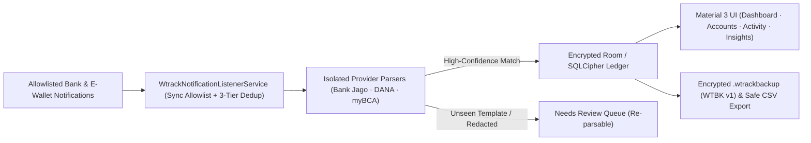

<div align="center">


<h1>W-Track</h1>

<p>
  <strong>Local-first, privacy-focused Android personal finance aggregator</strong><br />
  Powered by on-device notification ingestion, isolated provider parsers, and SQLCipher encryption.
</p>

<p>
  
  
  
  
  
  
</p>

<p>
  <a href="#privacy--security">Privacy &amp; Security</a> ·
  <a href="#how-it-works">How It Works</a> ·
  <a href="#supported-providers">Providers</a> ·
  <a href="#progress">Progress</a> ·
  <a href="#roadmap">Roadmap</a> ·
  <a href="#architecture">Architecture</a> ·
  <a href="#build--test">Build &amp; Test</a> ·
  <a href="#documentation">Documentation</a>
</p>

</div>

---

W-Track automatically collects transaction notifications from explicitly allowlisted Indonesian banking and e-wallet apps, normalizes them into a single encrypted local ledger, routes uncertain alerts to **Needs Review**, and helps you track balances, transfers, categories, and cash flow without uploading financial data or storing banking credentials.

> [!NOTE]
> **Current Status:** All PRD v1.4 features are implemented (`M0`–`M5`) with `7/7` hardware instrumented test suites and R8 release builds verified (`0.2.0-rc1`, `versionCode 2`, `minSdk 26 · targetSdk 36 · compileSdk 37`). Currently in active **Gate G1** daily-driver soak on `iQOO Z10R (Android 16)`.

---

## Privacy & Security

| Guarantee | How W-Track Enforces It |
| :--- | :--- |
| **100% Local-First & Offline** | No cloud account, no telemetry, and no mandatory backend. All parsing, categorization, and reporting run on-device. |
| **Zero Banking Credentials** | Never asks for or stores bank logins, passwords, PINs, OTPs, or CVVs. |
| **No Screen Scraping or Accessibility** | Reads only standard Android `NotificationListenerService` events from apps you explicitly enable in the allowlist. |
| **Encrypted Storage & Backups** | Local SQLite database is encrypted with `sqlcipher-android` (`4.20.0`) + Android Keystore AES-GCM key wrapping; `.wtrackbackup` archives (`WTBK` v1) use Argon2id + AES-256-GCM. |
| **Safe Failure Handling** | Unseen notification formats or Android-redacted security alerts never guess amounts or directions — they route cleanly to **Needs Review** (or discard payloads for `SECURITY_NOTICE`). |

---

## How It Works



---

## Supported Providers

Verified on `iQOO Z10R` (`Android 16`):

| Priority | Provider | Package ID | Parser | What's Supported |
| :-: | :--- | :--- | :--- | :--- |
| **1** | **Bank Jago** | `com.jago.digitalBanking` (`v8.99.1`) | `JagoTransactionParser` **v2** | Incoming & outgoing transfers, Android 16 group summaries, and **`Main Pocket`-only** pocket-to-pocket monitoring (movements solely between non-Main sub-pockets are ignored cleanly). |
| **2** | **DANA** | `id.dana` (`v2.152.0`) | `DanaTransactionParser` **v1** | Incoming transfers, quest/mission promo filtering on the shared FCM channel, and Android 16 group summaries. |
| **3** | **myBCA** | `com.bca.mybca.omni.android` (`v2.23.0`) | `BcaTransactionParser` **v1** | Financial Diary received & spent pushes and Android 16 group summaries. *(BCA mobile `com.bca` v4.9.5 is verified installed; zero Financial Diary pushes observed from `com.bca`.)* |

> [!TIP]
> Any notification template not yet covered (such as QRIS payments, outgoing DANA transfers, refunds, or failed attempts) automatically routes to **Needs Review** without guessing fields and can be re-parsed later as parsers expand.

---

## Progress

| Milestone | Scope & Implemented Features | Verification Status |
| :--- | :--- | :--- |
| **M0: Foundation** | 3-module Gradle setup (`:app`, `:integration:api`, `:integration:providers`) + `build-logic` conventions (`isMinifyEnabled` + `isShrinkResources` + optional `keystore.properties` release signing), Hilt `2.60.1` DI, Material 3 Light/Dark/System themes, pure-Kotlin boundary tests. | **Complete & R8-verified** (`33.0 MB` debug → `11.0 MB` release APK) |
| **M1: Encrypted Data Foundation** | Room Schema v1 + SQLCipher `4.20.0` + `DatabaseKeyManager` (KEK/DEK lifecycle + `LOCKED_KEY_MISSING_OR_INVALID` lock screen recovery). | **Hardware-verified** on `iQOO Z10R` (`SqlCipherInstrumentedTest`: TEE Keystore audit, header & key-loss byte preservation) |
| **M2: Notification Ingestion** | Provider-agnostic `WtrackNotificationListenerService`, synchronous allowlist filter, `activeNotifications` catch-up, 3-tier deduplication, `ING-08`/`ING-10` capture self-check & App Info guidance, `ING-12`/`13`/`14` recovery & heartbeat, M3a sample capture protection, anonymized JSON export, purge, and `PAR-11` guarded re-parse proposals. | **Hardware-verified** on `iQOO Z10R` (`IngestionAndLedgerInstrumentedTest`) & live on daily driver |
| **M3: Providers & Domain Engines** | Production parsers for Bank Jago (`v2`), myBCA (`v1`), and DANA (`v1`); 16-row Section 4.6 aggregate engine + `DASH-08` merchant trends; balance correction & checkpoints; manual transfer pairing with derived fees; auto-categorization rules with backfill; `TX-06` tags & filtering; `GateG1Evaluator`. | **Hardware-verified** against anonymized captures & `iQOO Z10R` SQLCipher ledger invariants |
| **M4: Material 3 UI** | Onboarding + Capture Self-Check + Notification Access/battery/restricted-settings guidance, Dashboard, Accounts (grouped IDR/USD/JPY input & balance correction), Activity (tag filtering, edit, void, transfer linking), Needs Review, Rules, Insights (merchant trends), Settings (`DATA-12` reminder threshold chips & `DATA-14` SAF backup folder config), and `DatabaseLockedScreen`. | **Theme & Lock UI verified** on `iQOO Z10R` (`ComposeThemeAndLockedUiInstrumentedTest`) |
| **M5: Reliability & Safety** | Encrypted `.wtrackbackup` (`WTBK` v1 Argon2id `65,536 KiB` / `3` iter + PBKDF2 fallback + AES-256-GCM AAD) export/verify/atomic restore, scheduled backup reminder evaluator (`EXP-006`/`DATA-14`), CSV export with unencrypted warning & formula neutralization, `RetentionPurgeWorker`, and complete data wipe. | **Hardware-verified** on `iQOO Z10R` (`BackupAndRetentionInstrumentedTest`: `encryptMs=9879`, `decryptMs=8943`, 13-table atomic restore, retention & CSV safety) |

---

## Roadmap

### 1. Gate G1 Empirical Validation *(In Progress)*
- Collect **7–14 consecutive days** of real usage with **≥ 30 statement transactions per provider** against official provider statements as ground truth ([docs/PROVIDERS.md](docs/PROVIDERS.md) Appendix C).
- Validate Gate G1 acceptance thresholds: **Coverage ≥ 90%**, **Completeness ≥ 95%**, and **0** unexplained wrong amounts or directions.

### 2. Provider Parser Expansion
- Capture and add anonymized templates for **QRIS merchant payments**, **outgoing DANA transfers**, **refunds & reversals**, **failed attempts**, and **transfer admin fees**.
- Observe and handle **dual-notifier overlap** (e.g., a DANA QRIS purchase funded by Bank Jago or myBCA debit firing notifications from both apps).

### 3. Remaining Manual & Real-OS Hardware Checks
Full execution tracking lives in [docs/PHYSICAL_DEVICE_TEST_CHECKLIST.md](docs/PHYSICAL_DEVICE_TEST_CHECKLIST.md). Automated `SqlCipherInstrumentedTest`, `BackupAndRetentionInstrumentedTest`, `IngestionAndLedgerInstrumentedTest`, and `ComposeThemeAndLockedUiInstrumentedTest` suites (`7/7`) and R8 release builds are verified on `iQOO Z10R`; remaining manual/OS observations are:
- **Physical reboot & locked-screen AFU delivery:** Confirm BFU → AFU transition after real device reboot and live screen-off notification ingestion without unlocking UI.
- **OriginOS / Android 16 live Doze & `am kill` observation:** Real listener survival/recovery across overnight idle (`wait_for_unlock=true`), battery optimization toggle (`ING-10`), permission revocation (`ACCESS_REVOKED`), live OTP redaction, and Android 16 `ProgressStyle`/Cooldown notifications.
- **Interactive SAF & Release QA:** Manual UI tap-through of Android SAF `.wtrackbackup` / CSV pickers, double-confirmed wipe dialog, Light/Dark theme switch, and signed release install (once local `keystore.properties` is provisioned).

### 4. Post-MVP Direction
- Additional Indonesian banks & e-wallets isolated cleanly inside `:integration:providers`.
- Multi-OEM testing beyond `vivo / iQOO Z10R` and refined credit-card workflows.

---

## Architecture

```text
W-Track/
├── app/                     # Android app: Compose Material 3 UI, domain use-cases, Room/SQLCipher data, WorkManager, NLS ingestion
├── integration/
│   ├── api/                 # Pure Kotlin parser contracts (TransactionParser, ParseResult, NotificationEvent, ParsedTransaction)
│   └── providers/           # Isolated provider parsers (jago, dana, bca), shared locale/date helpers, catalog & anonymized fixtures
├── build-logic/             # Shared Gradle convention plugins
└── docs/                    # PRD, Architecture, Technical Spec, Database ERD, Security, ADRs, Provider & Device checklists
```

### Tech Stack

| Layer | Technologies |
| :--- | :--- |
| **UI & State** | Jetpack Compose (BOM `2026.09.00`), Material 3, Navigation Compose `2.10.2`, ViewModel + `StateFlow` |
| **Dependency Injection** | Hilt `2.60.1`, Hilt Navigation Compose `1.3.0`, Hilt Work `1.3.0` |
| **Persistence** | Room `2.8.5` (`KSP`), `net.zetetic:sqlcipher-android:4.20.0`, DataStore Preferences `1.3.0` |
| **Background & Crypto** | WorkManager `2.12.0` (`hilt-work`), BouncyCastle `bcprov-jdk18on:1.80.2`, `kotlinx-serialization-json:1.9.0` |
| **Build & Release** | Kotlin `2.2.21`, AGP `9.5.1`, R8 Shrinking & Resource Shrinking (`33.0 MB` → `11.0 MB`), `minSdk 26 · targetSdk 36 · compileSdk 37` |
| **Testing** | JUnit 4, Google Truth, Turbine, Kotlinx Coroutines Test, Room Testing, Robolectric `4.18.1`, AndroidX Test |

---

## Build & Test

Run unit tests, Robolectric suites, lint, and R8 release build verification:

```bash
./gradlew test testDebugUnitTest lintDebug assembleRelease
```

> [!WARNING]
> Avoid `./gradlew connectedDebugAndroidTest` on a daily-driver device with live financial data, as its teardown uninstalls `wtrack.app`. Use the isolated instrumentation workflow below instead.

Run isolated hardware instrumented tests without uninstalling existing daily-driver app data:

```bash
./gradlew assembleDebug assembleDebugAndroidTest
adb install -r app/build/outputs/apk/debug/app-debug.apk
adb install -r app/build/outputs/apk/androidTest/debug/app-debug-androidTest.apk
adb shell am instrument -w -e debug false wtrack.app.test/androidx.test.runner.AndroidJUnitRunner
adb uninstall wtrack.app.test
```

---

## Documentation

| Document | Purpose |
| :--- | :--- |
| [docs/PRD.md](docs/PRD.md) | Frozen Product Requirements Document (v1.4) & Appendix C Gate G1 format |
| [docs/ARCHITECTURE.md](docs/ARCHITECTURE.md) | Module boundaries, layer dependencies, and runtime architecture |
| [docs/TECHNICAL_SPEC.md](docs/TECHNICAL_SPEC.md) | Ingestion pipeline, normalization rules, deduplication, and calculation specs |
| [docs/DATABASE_ERD.md](docs/DATABASE_ERD.md) | Room schema entities, indices, foreign keys, and invariants |
| [docs/SECURITY.md](docs/SECURITY.md) | Threat model, SQLCipher KEK/DEK lifecycle, retention rules, and backup crypto |
| [docs/IMPLEMENTATION_PLAN.md](docs/IMPLEMENTATION_PLAN.md) | Full `M0`–`M5` milestone breakdown and engineering backlog (`45` items) |
| [docs/PROVIDERS.md](docs/PROVIDERS.md) | Installed package registry, observed templates, and Gate G1 evidence table |
| [docs/PHYSICAL_DEVICE_TEST_CHECKLIST.md](docs/PHYSICAL_DEVICE_TEST_CHECKLIST.md) | Physical `iQOO Z10R` verification checklist |
| [docs/ADR/](docs/ADR/) | Architecture Decision Records (`ADR-001` through `ADR-006`) |
