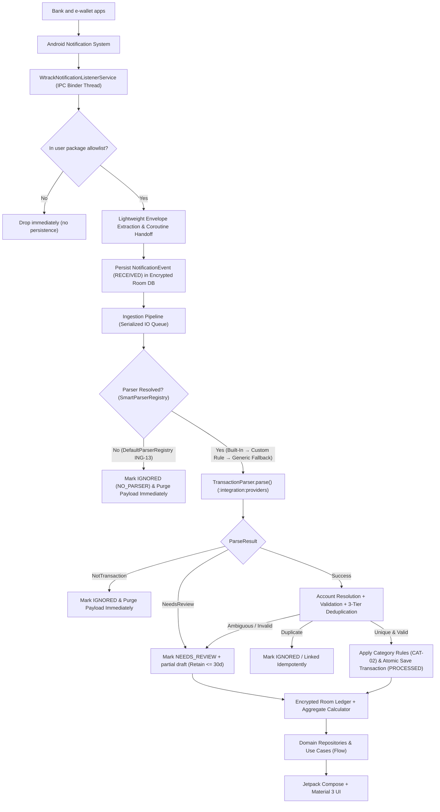
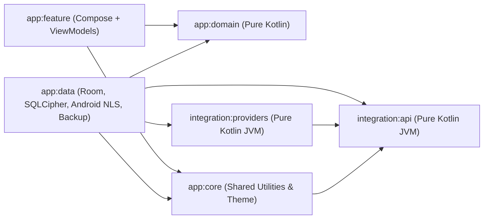

# Architecture — W-Track

**Document Status:** Active Architecture Baseline (aligned to PRD v1.4 + Custom Pattern Parsing)  
**Last Updated:** 2026-11-22

---

## 1. System Overview & Architectural Principles

W-Track is a local-first, offline-capable personal finance aggregator for Android that collects transaction events from user-selected financial apps via Android's `NotificationListenerService`, normalizes them into a canonical ledger, and stores everything locally inside an encrypted SQLite database.

Every architectural choice adheres directly to **PRD v1.4 Section 2 (Principles)** and **Section 1.4 (Non-Goals)**:

| Principle | Architectural Realization |
| :--- | :--- |
| **Automatic-first** | `NotificationListenerService` captures allowlisted notifications into an encrypted event inbox and runs deterministic provider parsers automatically. |
| **Local-first & Offline-capable** | Zero mandatory backend, zero cloud account, zero `INTERNET` requirement for MVP; Room `Flow` + DataStore drive all screens offline. |
| **Privacy-first** | Strict per-package allowlist evaluated synchronously before persistence; zero `AccessibilityService`, zero credential/OTP collection; bounded payload retention; encrypted storage from schema v1. |
| **Transparent & Reconcilable** | Capture status derives from observable OS/service signals (`ACTIVE`, `ATTENTION`, `DISCONNECTED`, `UNSUPPORTED`); possible gaps (`ING-11`, `ING-14`), balance checkpoints (`ACC-07`), and manual balance adjustments (`ACC-08`) stay explicit. |
| **Recoverable** | Incomplete, ambiguous, or failing events route to `NEEDS_REVIEW` (`NotificationEvent`), never into `Transaction`, and unfinished events recover across process death (`ING-12`). |
| **Extensible** | Pure-Kotlin `:integration:api` isolates provider parsers in `:integration:providers` from Android, Room, and UI. |

---

## 2. High-Level Component & Data-Flow Architecture



---

## 3. Module & Package Architecture

Per **ADR-001** and **PRD Section 12**, the project is structured as a **modular monolith with three Gradle modules** plus a `build-logic` composite build for convention plugins.

```text
W-Track/
├── build-logic/                  # Gradle convention plugins (Android app/lib, JVM, Compose, Hilt)
├── integration/
│   ├── api/                      # Pure Kotlin JVM: TransactionParser, ParseResult, NotificationEvent, Enums
│   └── providers/                # Pure Kotlin JVM: Provider parsers, generic fallback, safe template engine & fixtures
├── app/                          # Android Application module
│   └── src/main/java/wtrack/app/
│       ├── core/                 # M3 theme, currency specs, clock abstraction, logging redaction, DI qualifiers
│       ├── data/
│       │   ├── crypto/           # Android Keystore KEK + wrapped DEK + StartupStateManager
│       │   ├── local/            # Room DB (SQLCipher), entities, DAOs, migrations, DataStore settings
│       │   ├── ingestion/        # NotificationListenerService, allowlist gate, pipeline, recovery, heartbeat
│       │   ├── repository/       # Repository implementations mapping Room <-> Domain
│       │   ├── worker/           # WorkManager: retention purge, backup reminder, fallback heartbeat
│       │   └── backup/           # Encrypted backup writer/reader, atomic restore, CSV exporter
│       ├── domain/
│       │   ├── model/            # Canonical models (Account, Transaction, NeedsReviewItem, TransferPair, etc.)
│       │   ├── repository/       # Pure Kotlin repository interfaces & request DTOs
│       │   ├── usecase/          # Ingestion orchestration, aggregates, reconciliation, transfer linking, rules
│       │   └── exception/        # Domain errors (DatabaseLockedException, InvalidTransferPairException, etc.)
│       └── feature/              # Jetpack Compose screens & ViewModels + navigation (WtrackNavHost)
└── docs/                         # Architecture, Technical Spec, ERD, Security, Implementation Plan, ADRs
```

### Module & Layer Dependency Rules



**Enforced Dependency Rules:**
1. `:app` depends on `:integration:api` and `:integration:providers`.
2. `:integration:providers` depends **only** on `:integration:api` (zero Android dependencies).
3. `wtrack.app.domain` has **zero dependencies** on `android.*`, `androidx.room.*`, `androidx.compose.*`, `net.zetetic.*`, or `wtrack.integration.providers.*`. Enforced via code review and an automated JUnit package-dependency check in M0 (`CORE-002`).
4. `wtrack.app.feature` communicates **only** with `wtrack.app.domain` interfaces and use cases — never directly with Room DAOs, `TransactionParser` instances, or SQLCipher helpers.

---

## 4. Threading, Concurrency & Pipeline Execution Model

### 4.1 Listener Callback Budget (`NotificationListenerService`)
`onNotificationPosted(sbn)` executes on an Android Binder IPC thread. To prevent ANRs, binder exhaustion, or OS-initiated unbinding during notification bursts:
1. Check `sbn?.packageName` against an in-memory `AtomicReference<Set<String>>` allowlist snapshot (`O(1)` lookup). Non-allowlisted notifications return immediately.
2. Extract only minimal immutable fields into an in-memory `PendingNotificationEnvelope` (reading `Notification.extras` strings safely with defensive try/catch).
3. Enqueue the envelope into an application-scoped `Channel<PendingNotificationEnvelope>(capacity = Channel.BUFFERED)` or trigger an immediate bounded IO persist call via `applicationScope.launch(ioDispatcher)`. Never run Room transactions, regex parsing, or crypto initialization synchronously on the Binder thread.

### 4.2 Serialized Ingestion Worker & Burst Safety
Rapid notifications (e.g., multiple payments or a provider posting an update 100ms after initial post) create race conditions if parsed concurrently across threads.
- **Two-Stage Persistence:** Stage 1 quickly persists `NotificationEvent(status = RECEIVED)` into SQLite; Stage 2 processes queued `RECEIVED` events **sequentially** on a single-threaded or mutex-serialized `Dispatchers.IO` pipeline coroutine (`Mutex` / `limitedParallelism(1)`).
- **Benefit:** Deduplication checks (`provider_reference`, `stable_event_key`, composite fingerprint) and `AccountSource` lookups are strictly ordered and free of write-skew or duplicate-insert races, while Stage 1 ensures burst notifications are safely persisted even if Stage 2 lags slightly.

### 4.3 Role of `WorkManager`
Per **PRD Section 4.2**, `WorkManager` is **never** used as the real-time notification ingestion path because Doze and OEM scheduling batch/delay jobs. `WorkManager` is strictly reserved for deferred periodic maintenance:
- Payload retention & log purge job (`SEC-002`, e.g., daily / every 12h).
- Backup reminder evaluation (`EXP-005`, `DATA-12`).
- Low-frequency fallback heartbeat check (`ING-14`, complementing active listener heartbeats).

---

## 5. Lifecycle, Process Death & Recovery Architecture

Android kills background processes aggressively. W-Track uses four layered mechanisms so accepted events are never silently dropped and unobserved outages remain transparent:

1. **Rebind & Catch-Up Scan (`ING-09`):**
   - `onListenerDisconnected()` requests rebind (`NotificationListenerService.requestRebind`) on API 24+ and logs an open `CaptureGap(LISTENER_DISCONNECTED)`.
   - `onListenerConnected()` closes open gaps, fetches `activeNotifications` currently in the notification drawer, and feeds allowlisted notifications into the idempotent pipeline.
   - Limitation communicated to user (`PRD Section 20`): notifications already swiped away or cleared before reconnect cannot be recovered via `activeNotifications`.
2. **Startup & Connect Event Recovery (`ING-12`):**
   - On `Application.onCreate` / pipeline startup and on `onListenerConnected`, scan `notification_events` for:
     - `RECEIVED` events (persisted before process died prior to processing).
     - `PROCESSING` events whose `updated_at` / processing lease is older than the grace period (proposed: 60 seconds).
     - `FAILED` events below `MAX_ATTEMPTS` (proposed: 3).
   - Re-run them through the serialized pipeline; if an event fails `MAX_ATTEMPTS` times, escalate it to `NEEDS_REVIEW` with `ReviewReason.PIPELINE_ERROR` so no accepted event remains invisible.
3. **Observable & Heartbeat Capture Gaps (`ING-11`, `ING-14`):**
   - `ING-11`: Deterministic `CaptureGap` rows created when Notification Access permission toggles off → on (`ACCESS_REVOKED`) or `onListenerDisconnected` → `onListenerConnected` (`LISTENER_DISCONNECTED`).
   - `ING-14`: Best-effort heartbeat timestamp stored every 15 minutes (when running) and on every processed event. On listener connect or app start, if `now - lastHeartbeat > 3 hours` (configurable), record `CaptureGap(HEARTBEAT_STALE)`. Exposed clearly as a *"Possible gap"* badge (since OS kill and powered-off phone look identical).
4. **Android 15+/16 Notification & OEM Doze Resilience (`ING-06`, `ING-10`, `PRD Section 5`):**
   - Android 15/16 may redact OTP-like notification payloads before delivering to non-privileged `NotificationListenerService`. Android 16 (API 36) also introduces `Notification.ProgressStyle` / Live Updates (Promoted Ongoing) and Notification Cooldown. The extraction layer detects empty/redacted indicators (`isContentRedacted`) without attempting OS permission bypasses, safely ignores non-transaction Live Update progress ticks without causing Binder ANRs, and routes likely redacted financial alerts to `NEEDS_REVIEW`.
   - Confirmed ADB diagnostics on the primary `vivo` / `iQOO Z10R` (`I2505`, Android 16 / API 36) test device show both **Light Doze** and **Deep Doze** active in device history with **`wait_for_unlock=true`** (while bench state was `ACTIVE`, which proves nothing about background survivability). Therefore, baseline PoC testing MUST evaluate default battery settings first without auto-whitelisting W-Track before validating `ING-10` guidance.

---

## 6. Presentation, Navigation & Phasing Architecture

### 6.1 Full MVP Navigation Architecture (M4)
- **Framework:** Jetpack Compose + Material 3 + Jetpack Navigation (`NavHost`), adaptive System / Light / Dark theme (`PRD Section 10.1`).
- **Four Primary Bottom-Navigation Destinations (`PRD Section 10.2`):**
  1. **Home (Dashboard):** Income, expenses, net cash flow, unreconciled difference (`DASH-09`), period selector, account balance summary, recent transactions, prominent **Needs Review** badge/card, backup reminder banner.
  2. **Activity:** Chronological searchable/filterable ledger (including `Uncategorized` and `Show voided`), transaction detail (original vs edited values + source payload during retention window), edit/void/restore, refund linking, manual entry (`TX-07`), transfer pairing (`TRF-01`).
  3. **Accounts:** Account list, estimated balances + last reconciled timestamp, balance correction (`ACC-08`), capture status (`ACTIVE`, `ATTENTION`, `DISCONNECTED`, `UNSUPPORTED`), possible gap badges, `AccountSource` hints, unparsed counter (`ING-13`).
  4. **Insights:** Category spending breakdown (explicit `Uncategorized` slice), monthly comparison, merchant analysis (`COULD`), budgets (`COULD`).
- **Secondary Flows:**
  - **Onboarding:** Privacy & Notification Access rationale → permission handoff → OEM battery/autostart & sideload restricted-settings guidance → allowlist → account creation → optional initial balance → test-capture step.
  - **Needs Review Queue:** Event source, `posted_at`, `ReviewReason`, editable partial fields, account selector/remember hint (`REV-07`), Save / Retry / Ignore.
  - **Settings:** Theme, Notification Access & allowlist, categorization rules list (`CAT-05`), encrypted full backup/restore/verification, CSV export (`SHOULD`), retention window (`0–30 days`), data wipe (`DATA-06`), diagnostics (non-sensitive), privacy disclosures.
  - **Database Locked State (`ADR-005`):** Dedicated blocking recovery flow when `StartupState == LOCKED_KEY_MISSING_OR_INVALID` (Restore from full backup or explicitly delete/reset).

### 6.2 Strict PoC UI Restraint (M0–Gate G1)
Per **PRD Section 17.1**, M0–M3a must **not** polish the full dashboard, charts, or secondary screens before Gate G1 passes. Before Gate G1, UI is limited strictly to:
- A minimal Compose shell for permission status, source allowlist toggle, sample-collection toggle (M3a only), captured transaction list, pending `NEEDS_REVIEW` count, and the `DATABASE_LOCKED` state test harness.

---

## 7. Repository State Assessment (`38001da` Baseline Observations)

Inspection of the git history shows commit `38001da` (*"feat: initial project setup with modular Android architecture"*), whose 45 files are currently unstaged-deleted in the local working tree (only `README.md` remains checked out on disk). Reviewing `38001da` reveals useful alignment as well as three critical defects that **must be corrected during M0/M1** rather than blindly restored:

| Item from `38001da` | Assessment | Action Required in M0/M1 |
| :--- | :--- | :--- |
| Three-module Gradle structure (`app`, `integration:api`, `integration:providers`) & `build-logic` | Aligned with PRD Section 12 & ADR-001. | Preserve layout when M0 begins. |
| `net.zetetic:android-database-sqlcipher:4.5.4` in `libs.versions.toml` & draft `ADR-005` | **Critical Defect:** Legacy 4.5.4 is EOL and lacks 16KB memory page alignment (crashes on 16KB Android 15+/16 devices). | Replace with **`net.zetetic:sqlcipher-android:4.20.0`** (if `compileSdk = 37` GA decoupled) or **`4.17.0`** (if strict `compileSdk = 36`), using `SupportOpenHelperFactory`. SQLCipher 5 beta is prohibited. |
| `docs/FRONTEND_CONTRACT.md` shared `wtrack.integration.TransactionType` in `domain` | **Contract Gap:** Missing `ADJUSTMENT` (`ACC-08`), missing `Merchant`/`TransactionRule`/`Category`/`Tag` contracts, missing `originalJson` edit safety details. | Introduce `DomainTransactionType` (including `ADJUSTMENT`) in `domain` and align models against `TECHNICAL_SPEC.md`. |
| `wtrack.integration.NotificationEvent` had only a single `text: String` | **Ingestion Limitation:** Real notifications split data across `title`, `text`, `bigText`, `subText`, `channelId`, and redaction flags. | Enrich `:integration:api`'s `NotificationEvent` contract before M2/M3a parser implementation. |
| `compileSdk = 37`, `agp = 9.5.1`, `coreKtx = 1.19.1` in `libs.versions.toml` | **SDK / Plugin Alignment Needed:** Owner proposes `minSdk = 26`, `compileSdk = 36`, `targetSdk = 36` (no Android 17 beta). Note: `core-ktx:1.19.1` and `sqlcipher-android:4.18+`–`4.20.0` bump `compileSdk` to `37`, and AGP 9.0+ embeds built-in Kotlin (rejecting `org.jetbrains.kotlin.android`). | Confirm Option A (`compileSdk = 36` strict + `core-ktx:1.18.0` + `sqlcipher:4.17.0` fallback) vs Option B (`compileSdk = 37` GA + `targetSdk = 36`) in ADR-003/ADR-005 before M0. |
