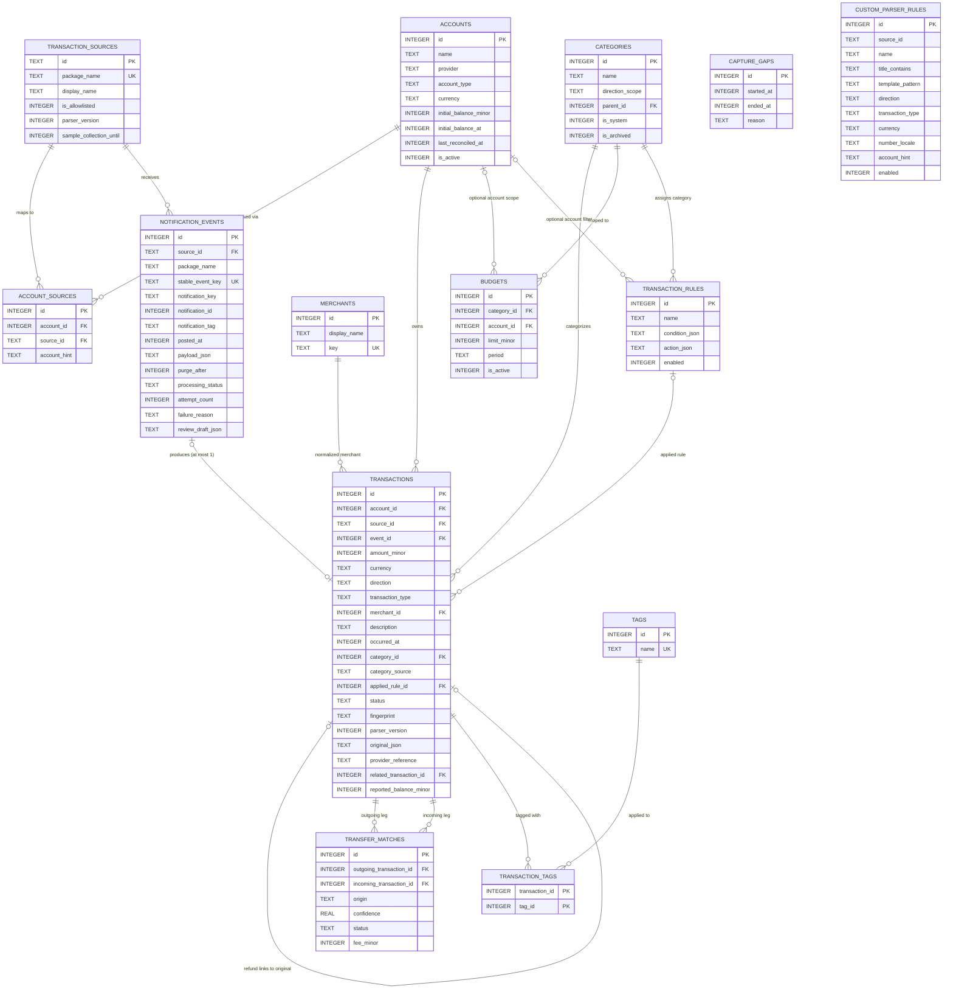

# Database Schema & Entity-Relationship Design — W-Track

**Document Status:** M1 Foundation & Schema v2 Custom Parser Specification (PRD v1.4+)  
**Encryption:** SQLCipher for Android (`net.zetetic:sqlcipher-android`: `4.20.0` evaluated / `4.17.0` strict-API-36 fallback; no 5 beta, no EOL `4.5.4`) from Schema Version 1 (Schema v2 adds `custom_parser_rules` via `MIGRATION_1_2`)  
**Last Updated:** 2026-11-22

---

## 1. Entity-Relationship Diagram

All 13 entities prescribed in **PRD Section 7.2 & 7.3** plus `custom_parser_rules` (Schema v2) and required foreign keys and cardinalities:



---

## 2. Detailed Table & Column Specifications

### 2.1 `accounts` (`DB-001`, M1)
| Column | SQLite Type | Null | Default | Constraints / Notes |
| :--- | :--- | :--- | :--- | :--- |
| `id` | `INTEGER` | NO | AutoInc | `PRIMARY KEY` |
| `name` | `TEXT` | NO | — | User-facing account name (`ACC-03`) |
| `provider` | `TEXT` | NO | — | Provider label (e.g., bank/wallet name or `"Cash"`) |
| `account_type` | `TEXT` | NO | — | Enum: `BANK`, `EWALLET`, `CASH`, `CREDIT_CARD`, `OTHER` (`ACC-02`) |
| `currency` | `TEXT` | NO | — | ISO 4217 3-letter uppercase code (e.g., `IDR`) |
| `initial_balance_minor` | `INTEGER` | YES | `NULL` | Optional opening balance in minor units (`ACC-04`) |
| `initial_balance_at` | `INTEGER` | YES | `NULL` | UTC epoch millis; `CHECK` enforced: `(initial_balance_minor IS NULL AND initial_balance_at IS NULL) OR (initial_balance_minor IS NOT NULL AND initial_balance_at IS NOT NULL)` |
| `last_reconciled_at` | `INTEGER` | YES | `NULL` | UTC epoch millis of last balance correction (`ACC-09`) |
| `is_active` | `INTEGER` | NO | `1` | `1` active, `0` archived (`ACC-01`) |
| `created_at` | `INTEGER` | NO | — | UTC epoch millis |
| `updated_at` | `INTEGER` | NO | — | UTC epoch millis |

### 2.2 `transaction_sources` (`DB-003`/`DB-006`, M1)
| Column | SQLite Type | Null | Default | Constraints / Notes |
| :--- | :--- | :--- | :--- | :--- |
| `id` | `TEXT` | NO | — | `PRIMARY KEY`; stable source identifier (matches `TransactionParser.sourceId` / package name) |
| `package_name` | `TEXT` | NO | — | `UNIQUE`; Android app package name (`ING-03`) |
| `display_name` | `TEXT` | NO | — | Installed app label shown in UI |
| `is_allowlisted` | `INTEGER` | NO | `0` | `1` if user enabled capture (`ING-03`, `ING-04`) |
| `parser_version` | `INTEGER` | YES | `NULL` | Active compatible parser version, `NULL` when `UNSUPPORTED` (`ING-13`) |
| `sample_collection_until` | `INTEGER` | YES | `NULL` | Opt-in M3a raw sample retention deadline (`<= now + 14d`), `NULL` when off (PRD Section 11) |
| `created_at` | `INTEGER` | NO | — | UTC epoch millis |
| `updated_at` | `INTEGER` | NO | — | UTC epoch millis |

### 2.3 `account_sources` (`DB-006`, M1 schema ready for `ACC-05`)
| Column | SQLite Type | Null | Default | Constraints / Notes |
| :--- | :--- | :--- | :--- | :--- |
| `id` | `INTEGER` | NO | AutoInc | `PRIMARY KEY` |
| `account_id` | `INTEGER` | NO | — | `FK -> accounts(id) ON DELETE CASCADE` |
| `source_id` | `TEXT` | NO | — | `FK -> transaction_sources(id) ON DELETE CASCADE` |
| `account_hint` | `TEXT` | YES | `NULL` | Masked account suffix/hint only (never full account number); `NULL` for single-account default |
| `created_at` | `INTEGER` | NO | — | UTC epoch millis |

> **Critical SQLite Uniqueness Rule (Appendix A):** Standard SQLite `UNIQUE(source_id, account_hint)` treats multiple `NULL` hints as distinct! Therefore we enforce **two partial unique indexes**:
> - `CREATE UNIQUE INDEX idx_account_sources_source_hint ON account_sources(source_id, account_hint) WHERE account_hint IS NOT NULL`
> - `CREATE UNIQUE INDEX idx_account_sources_source_null_hint ON account_sources(source_id) WHERE account_hint IS NULL`
> This strictly guarantees **"at most one account per source may have an empty hint"** at the SQLite layer (`PRD Section 7.3`, `Appendix A`).

### 2.4 `notification_events` (`DB-003`, M1)
| Column | SQLite Type | Null | Default | Constraints / Notes |
| :--- | :--- | :--- | :--- | :--- |
| `id` | `INTEGER` | NO | AutoInc | `PRIMARY KEY` |
| `source_id` | `TEXT` | NO | — | `FK -> transaction_sources(id) ON DELETE RESTRICT` |
| `package_name` | `TEXT` | NO | — | Redundant copy for fast diagnostics & audit |
| `stable_event_key` | `TEXT` | NO | — | `UNIQUE`; SHA-256 deterministic idempotency key (Section 8.1) |
| `notification_key` | `TEXT` | YES | `NULL` | Android `sbn.key` recorded from PoC build 1 (`Section 8.1`) |
| `notification_id` | `INTEGER` | NO | — | Android `sbn.id` |
| `notification_tag` | `TEXT` | YES | `NULL` | Android `sbn.tag` (or SHA-256 hash if PII observed) |
| `posted_at` | `INTEGER` | NO | — | Android `sbn.postTime` UTC millis (time fallback, `PAR-12`) |
| `payload_json` | `TEXT` | YES | `NULL` | Encrypted at rest by SQLCipher; `NULL` once purged (`DATA-07`, `Section 9.3`) |
| `purge_after` | `INTEGER` | YES | `NULL` | UTC millis deadline for retention worker; `NULL` when already purged |
| `processing_status` | `TEXT` | NO | `'RECEIVED'` | Enum: `RECEIVED`, `PROCESSING`, `PROCESSED`, `NEEDS_REVIEW`, `IGNORED`, `FAILED` |
| `attempt_count` | `INTEGER` | NO | `0` | Incremented on each pipeline attempt; escalates at 3 (`ING-12`) |
| `failure_reason` | `TEXT` | YES | `NULL` | Holds `ReviewReason` or `NotTransactionReason` / `NO_PARSER` / `DUPLICATE` |
| `review_draft_json` | `TEXT` | YES | `NULL` | Serialized `PartialTransaction` for `NEEDS_REVIEW` items (`REV-01`) |
| `received_at` | `INTEGER` | NO | — | Local receipt UTC millis |
| `processed_at` | `INTEGER` | YES | `NULL` | UTC millis when terminal decision reached |
| `updated_at` | `INTEGER` | NO | — | UTC millis (used for stale `PROCESSING` grace-period check in `ING-12`) |

### 2.5 `transactions` (`DB-002`, M1)
| Column | SQLite Type | Null | Default | Constraints / Notes |
| :--- | :--- | :--- | :--- | :--- |
| `id` | `INTEGER` | NO | AutoInc | `PRIMARY KEY` |
| `account_id` | `INTEGER` | NO | — | `FK -> accounts(id) ON DELETE RESTRICT` |
| `source_id` | `TEXT` | YES | `NULL` | `FK -> transaction_sources(id) ON DELETE SET NULL`; `NULL` for manual & adjustment |
| `event_id` | `INTEGER` | YES | `NULL` | `FK -> notification_events(id) ON DELETE RESTRICT`; `NULL` for manual & adjustment |
| `amount_minor` | `INTEGER` | NO | — | `CHECK (amount_minor > 0)` (direction carries sign semantics; `IDR` exponent `2` ISO 4217 recommended per `ADR-004`) |
| `currency` | `TEXT` | NO | — | ISO 4217 uppercase code |
| `direction` | `TEXT` | NO | — | Enum: `INFLOW`, `OUTFLOW` |
| `transaction_type` | `TEXT` | NO | — | Enum: `PURCHASE`, `TRANSFER`, `FEE`, `REFUND`, `CASH`, `ADJUSTMENT`, `OTHER` |
| `merchant_id` | `INTEGER` | YES | `NULL` | `FK -> merchants(id) ON DELETE SET NULL` |
| `description` | `TEXT` | YES | `NULL` | Merchant raw/display or user description |
| `occurred_at` | `INTEGER` | NO | — | UTC epoch millis (parsed text time or `event.posted_at`) |
| `category_id` | `INTEGER` | YES | `NULL` | `FK -> categories(id) ON DELETE SET NULL` |
| `category_source` | `TEXT` | YES | `NULL` | `USER`, `RULE`, or `NULL` |
| `applied_rule_id` | `INTEGER` | YES | `NULL` | `FK -> transaction_rules(id) ON DELETE SET NULL` |
| `status` | `TEXT` | NO | `'CONFIRMED'` | Enum: `CONFIRMED`, `VOIDED` (`TX-08`) |
| `fingerprint` | `TEXT` | YES | `NULL` | Composite dedup fingerprint (Tier 3) |
| `parser_version` | `INTEGER` | YES | `NULL` | Parser version (`TX-05`); `NULL` for manual & adjustment |
| `original_json` | `TEXT` | YES | `NULL` | Immutable initial captured snapshot (`TX-03`); `NULL` for manual & adjustment |
| `provider_reference` | `TEXT` | YES | `NULL` | Provider reference ID (Tier 1 dedup + `TX-09` refund linking) |
| `related_transaction_id` | `INTEGER` | YES | `NULL` | `FK -> transactions(id) ON DELETE SET NULL` (refund link, `TX-09`) |
| `reported_balance_minor` | `INTEGER` | YES | `NULL` | Provider-reported balance snapshot for checkpoints (`ACC-07`), never displayed as authoritative |
| `created_at` | `INTEGER` | NO | — | UTC epoch millis |
| `updated_at` | `INTEGER` | NO | — | UTC epoch millis |

### 2.6 `categories`, `merchants`, `transaction_rules` (`DB-005` / `DB-007`)
- **`categories`:** `id` PK, `name` (`TEXT NOT NULL`), `direction_scope` (`TEXT`, nullable: `INFLOW`, `OUTFLOW`, or `NULL` for both), `parent_id` (`FK -> categories(id) ON DELETE SET NULL`), `is_system` (`INTEGER NOT NULL DEFAULT 0`), `is_archived` (`INTEGER NOT NULL DEFAULT 0`), `created_at` (`INTEGER NOT NULL`).
- **`merchants`:** `id` PK, `display_name` (`TEXT NOT NULL`), `key` (`TEXT NOT NULL UNIQUE` — normalized key per PRD Section 4.9), `created_at` (`INTEGER NOT NULL`).
- **`transaction_rules`:** `id` PK, `name` (`TEXT NOT NULL`), `account_id` (`INTEGER NULL`, `FK -> accounts(id) ON DELETE CASCADE` — nullable denormalized/indexed helper or extracted from condition), `category_id` (`INTEGER NOT NULL`, `FK -> categories(id) ON DELETE CASCADE`), `condition_json` (`TEXT NOT NULL`), `action_json` (`TEXT NOT NULL`), `enabled` (`INTEGER NOT NULL DEFAULT 1`), `created_at` (`INTEGER NOT NULL`), `updated_at` (`INTEGER NOT NULL`).

### 2.7 `transfer_matches` (`DB-004`, M1)
| Column | SQLite Type | Null | Default | Constraints / Notes |
| :--- | :--- | :--- | :--- | :--- |
| `id` | `INTEGER` | NO | AutoInc | `PRIMARY KEY` |
| `outgoing_transaction_id` | `INTEGER` | NO | — | `FK -> transactions(id) ON DELETE CASCADE` |
| `incoming_transaction_id` | `INTEGER` | NO | — | `FK -> transactions(id) ON DELETE CASCADE` |
| `origin` | `TEXT` | NO | `'MANUAL'` | `MANUAL` or `AUTO` |
| `confidence` | `REAL` | YES | `NULL` | `NULL` for `MANUAL` pairs |
| `status` | `TEXT` | NO | `'CONFIRMED'` | `SUGGESTED`, `CONFIRMED`, `REJECTED` |
| `fee_minor` | `INTEGER` | NO | `0` | `CHECK (fee_minor >= 0)` (`TRF-04`, Appendix A) |
| `created_at` | `INTEGER` | NO | — | UTC epoch millis |
| `CHECK` | — | — | — | `CHECK (outgoing_transaction_id != incoming_transaction_id)` |

### 2.8 `capture_gaps` (`DB-008`, M3c, `SHOULD`)
| Column | SQLite Type | Null | Default | Constraints / Notes |
| :--- | :--- | :--- | :--- | :--- |
| `id` | `INTEGER` | NO | AutoInc | `PRIMARY KEY` |
| `started_at` | `INTEGER` | NO | — | UTC epoch millis when interruption began |
| `ended_at` | `INTEGER` | YES | `NULL` | `NULL` while gap remains open (`ACCESS_REVOKED` / `LISTENER_DISCONNECTED`) |
| `reason` | `TEXT` | NO | — | `ACCESS_REVOKED`, `LISTENER_DISCONNECTED`, `HEARTBEAT_STALE` (`ING-11`, `ING-14`) |

### 2.9 `tags`, `transaction_tags`, `budgets` (M3c / `SHOULD`–`COULD`)
- **`tags`:** `id` PK, `name` (`TEXT NOT NULL UNIQUE COLLATE NOCASE`), `created_at`.
- **`transaction_tags`:** composite `PRIMARY KEY (transaction_id, tag_id)`, FKs to `transactions(id) ON DELETE CASCADE` and `tags(id) ON DELETE CASCADE`.
- **`budgets` (`DASH-07`, `COULD`):** `id` PK, `category_id` (`FK -> categories(id) ON DELETE CASCADE`), `account_id` (`INTEGER NULL`, `FK -> accounts(id) ON DELETE CASCADE`), `limit_minor` (`INTEGER NOT NULL CHECK (limit_minor > 0)`), `period` (`TEXT NOT NULL`, e.g., `MONTHLY`), `is_active` (`INTEGER NOT NULL DEFAULT 1`), `created_at`, `updated_at`.

### 2.10 `custom_parser_rules` (Schema v2 — User-Taught Notification Patterns)
| Column | SQLite Type | Null | Default | Constraints / Notes |
| :--- | :--- | :--- | :--- | :--- |
| `id` | `INTEGER` | NO | AutoInc | `PRIMARY KEY` |
| `source_id` | `TEXT` | NO | — | `INDEX`; target app package / source identifier |
| `name` | `TEXT` | NO | — | User-facing rule label |
| `title_contains` | `TEXT` | YES | `NULL` | Optional case-insensitive notification title filter |
| `template_pattern` | `TEXT` | NO | — | Safe placeholder template (`{AMOUNT}`, `{MERCHANT}`, `{REF}`, `{IGNORE}`) — never stores raw payloads or raw regex |
| `direction` | `TEXT` | NO | — | Enum: `INFLOW`, `OUTFLOW` |
| `transaction_type` | `TEXT` | NO | — | Enum: `PURCHASE`, `TRANSFER`, `FEE`, `REFUND` (`INFLOW` only), `CASH`, `OTHER` |
| `currency` | `TEXT` | NO | — | ISO 4217 3-letter uppercase code |
| `number_locale` | `TEXT` | NO | — | Enum: `INDONESIAN`, `ENGLISH` |
| `account_hint` | `TEXT` | YES | `NULL` | Optional masked account hint to attach to parsed transactions |
| `enabled` | `INTEGER` | NO | `1` | `1` active, `0` disabled |
| `created_at` | `INTEGER` | NO | — | UTC epoch millis |
| `updated_at` | `INTEGER` | NO | — | UTC epoch millis |

> **Privacy Guarantee:** `custom_parser_rules` stores only structural notification templates with placeholders (`{AMOUNT}`, `{MERCHANT}`, `{REF}`, `{IGNORE}`) — never raw notification payloads, amounts, or personal histories — so rules are safely included in encrypted `.wtrackbackup` archives.

---

## 3. Complete Index & Constraint Matrix (`PRD Appendix A`)

| Table | Index / Constraint | Type | Rationale |
| :--- | :--- | :--- | :--- |
| `transactions` | `(account_id)` | Index | Fast balance calculation & account filter (`TX-04`) |
| `transactions` | `(occurred_at DESC)` | Index | Chronological list & period dashboard queries (`TX-01`, `DASH-01`) |
| `transactions` | `(category_id)` | Index | Category breakdown & Uncategorized queries (`DASH-05`, `CAT-03`) |
| `transactions` | `(fingerprint)` | Index | Tier-3 duplicate matching (`Section 8.1`) |
| `transactions` | `(provider_reference)` | Index | Tier-1 dedup & automatic refund linking (`TX-09`) |
| `transactions` | `(related_transaction_id)` | Index | Refund-to-original lookups (`TX-09`) |
| `transactions` | `(event_id) WHERE event_id IS NOT NULL` | **Unique Partial Index** | Guarantees idempotency: at most 1 transaction per notification event |
| `notification_events` | `(stable_event_key)` | **Unique Index** | Tier-2 event idempotency (`Section 8.1`) |
| `notification_events` | `(processing_status, updated_at)` | Index | Fast Needs Review queue & `ING-12` recovery sweep |
| `notification_events` | `(purge_after) WHERE purge_after IS NOT NULL` | Index | Fast `WorkManager` retention purge query (`DATA-07`) |
| `notification_events` | `(notification_key)` | Non-unique Index | M3a / PoC key reuse & update evidence (`Appendix A`) |
| `notification_events` | `(source_id, failure_reason, received_at)` | Index | Fast 30-day `NO_PARSER` counter (`ING-13`) |
| `account_sources` | `(source_id, account_hint) WHERE account_hint IS NOT NULL` | **Unique Partial Index** | Prevents duplicate hints per source (`ACC-05`) |
| `account_sources` | `(source_id) WHERE account_hint IS NULL` | **Unique Partial Index** | Enforces at most one un-hinted default account per source |
| `merchants` | `(key)` | **Unique Index** | Normalized merchant identity (`Section 4.9`) |
| `transfer_matches` | `(outgoing_transaction_id) WHERE status = 'CONFIRMED'` | **Unique Partial Index** | A transaction belongs to at most one confirmed pair (`Appendix A`) |
| `transfer_matches` | `(incoming_transaction_id) WHERE status = 'CONFIRMED'` | **Unique Partial Index** | A transaction belongs to at most one confirmed pair (`Appendix A`) |
| `transfer_matches` | `CHECK (fee_minor >= 0)` | Check | Prevents invalid negative transfer fees (`TRF-04`) |
| `capture_gaps` | `(started_at, ended_at)` | Index | Overlapping gap lookup for Accounts screen (`ACC-09`) |
| `custom_parser_rules` | `(source_id)` | Index | Fast lookup of user-taught patterns per notification source |

---

## 4. Structured JSON Column Schemas

Stored via `kotlinx.serialization.json` inside SQLCipher-encrypted columns:

- **`notification_events.payload_json`:**
  ```json
  {
    "title": "Payment Success",
    "text": "...",
    "bigText": "...",
    "subText": null,
    "channelId": "tx_channel"
  }
  ```
  *(Set to `NULL` by purge job or immediately for ignored events.)*

- **`notification_events.review_draft_json`:**
  Serialized `PartialTransaction` (`amountMinor`, `currency`, `direction`, `type`, `occurredAtEpochMillis`, `merchantRaw`, `description`, `accountHint`, `providerReference`, `reportedBalanceMinor`).

- **`transactions.original_json` (`TX-03`):**
  ```json
  {
    "amountMinor": 5000000,
    "currency": "IDR",
    "direction": "OUTFLOW",
    "transactionType": "PURCHASE",
    "occurredAt": 1795142400000,
    "accountId": 1,
    "merchantRaw": "MERCHANT A",
    "description": "Payment to MERCHANT A"
  }
  ```

- **`transaction_rules.condition_json` & `action_json` (`CAT-02`):**
  - Condition: `{"merchantKey":"coffee shop","descriptionFragment":null,"accountId":1,"direction":"OUTFLOW"}`
  - Action: `{"categoryId":4}`

---

## 5. Schema Versioning, Migrations & Transactional Boundaries

### 5.1 Room Schema Versioning Plan
- **Export Schemas Always Enabled:** `room.schemaLocation = "$projectDir/schemas"` (`exportSchema = true`) in `:app` generates immutable JSON schema snapshots (`1.json`, `2.json`) verified against migrations.
- **Database Version 1 (M1 — PoC & Gate G1 Foundation):**
  Includes all 13 core tables (`accounts`, `transaction_sources`, `account_sources`, `notification_events`, `transactions`, `categories`, `merchants`, `transaction_rules`, `transfer_matches`, `capture_gaps`, `tags`, `transaction_tags`, `budgets`) encrypted with SQLCipher from creation (`ADR-005`).
- **Database Version 2 (Implemented — `MIGRATION_1_2`):**
  Adds `custom_parser_rules` and `index_custom_parser_rules_source_id` via `WtrackDatabase.MIGRATION_1_2`, verified in `WtrackDatabaseConstraintTest.migratesV1DatabaseToV2WithCustomParserRulesTableIntact` against exported `2.json`.

### 5.2 Required Atomic Database Transactions (`RoomDatabase.withTransaction`)
1. **Pipeline Commit:** Update `notification_events` (`PROCESSED` + `purge_after`) + upsert `merchants` (if needed) + insert `transactions` + update `last_alive_at` atomically.
2. **Needs Review Confirmation (`REV-04`):** Insert `transactions` + transition `notification_events` from `NEEDS_REVIEW` → `PROCESSED` + optionally insert `account_sources` hint (`REV-07`) atomically.
3. **Transfer Linking (`TRF-01`, `TRF-04`):** Re-verify both legs inside the DB transaction and insert `transfer_matches` atomically.
4. **Transaction Void / Unlink (`TX-08`):** Update `transactions.status = 'VOIDED'` and delete/unlink any associated `transfer_matches` atomically.
5. **Full Backup Restore (`DATA-09`):** After complete in-memory decryption, authentication, version verification, and FK validation, clear all tables and re-insert all restored entities in topological order inside a single `withTransaction` block.
