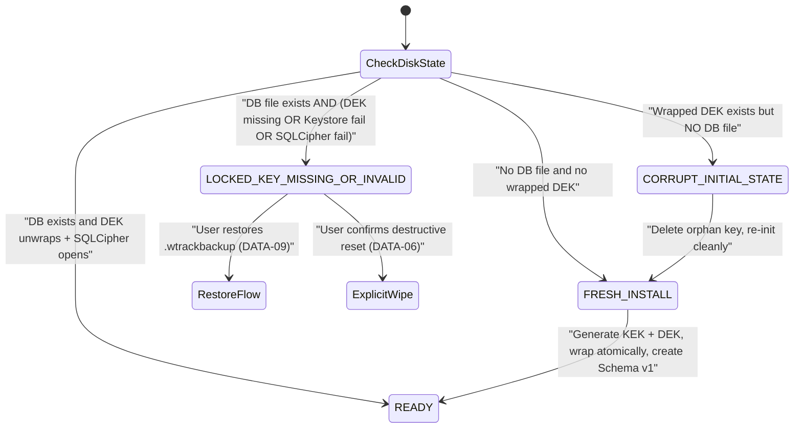

# Security and Privacy Specification — W-Track

**Document Status:** v1.0.0 Engineering Security Baseline (PRD v1.4 Section 9 + Daily-Driver Hardening)  
**Last Updated:** 2026-11-22

---

## 1. Security & Privacy Boundaries (Non-Negotiable Rules)

1. **Zero Banking Credentials:** Never ask for, collect, cache, or transmit bank usernames, passwords, PINs, card CVVs, or OTP codes (`PRD Section 1.4`, `Section 9.1`).
2. **Zero Screen Scraping / Accessibility Abuse:** Never declare or use Android `AccessibilityService` to read financial apps (`Section 1.4`).
3. **Zero Mandatory Network Transmission:** Core MVP features have no backend, no analytics telemetry SDKs, and no `INTERNET` permission requirement (`DATA-01`, `DATA-02`).
4. **Strict Synchronous Allowlist:** Non-allowlisted packages are dropped in memory inside `NotificationListenerService` without persisting payloads or metadata (`ING-04`).
5. **Encrypted From Day One:** Real financial notifications are captured during M2/M3a PoC; **no plaintext database or plaintext payload storage is permitted even during PoC** (`PRD Section 9.2`, `17.1`).
6. **Zero Sensitive Repo Artifacts:** Real financial payloads, account numbers, reference IDs, or personal histories must never be committed to git; fixtures must be synthetic or strictly anonymized (`Section 14.3`).

---

## 2. Threat Model

| # | Threat | Vector / Scenario | Impact | Mitigations | Verification |
| :-: | :--- | :--- | :--- | :--- | :--- |
| T1 | **Local storage extraction** | Rooted phone, physical seizure, or ADB backup extracts app files | Full transaction history & retained raw payloads exposed | SQLCipher AES-256 DB encryption from Schema v1 (`ADR-005`); `allowBackup="false"` + `dataExtractionRules` (`DATA-08`); no plaintext fallback | `TEST-004` / inspect `.db` header bytes for non-SQLite magic |
| T2 | **Silent DB wipe on Keystore fault** | OS update/corruption invalidates Keystore key (`KeyPermanentlyInvalidatedException`) | App silently creates empty DB over historical records | Startup state machine (`LOCKED_KEY_MISSING_OR_INVALID`) refuses overwrite, enters Locked screen, points to backup restore (`ADR-005`) | `TEST-004` / simulated deleted/corrupt wrapped key test |
| T3 | **Over-collection via Notification Access** | Android Notification Access grants OS visibility into *all* apps | Chat, email, OTPs, personal alerts captured unintentionally | Explain OS scope before prompting (`Section 9.1`); immediate allowlist filter in `onNotificationPosted`; ignore disallowed packages before allocation/DB write | Integration test verifying disallowed packages produce 0 DB rows |
| T4 | **Android 15+/16 OTP / sensitive content redaction & lock-screen masking** | Android 15/16 redacts notifications suspected of holding OTP-like strings or masks lock-screen content | Parser crashes or fabricates/guesses amounts from redacted text | Detect empty/redacted content safely (`ING-06`), route to `NEEDS_REVIEW`, never attempt privileged bypass (`RECEIVE_SENSITIVE_NOTIFICATIONS`) | Device test on `iQOO Z10R` (Android 16 / API 36, `Section 14.3`) |
| T5 | **Sensitive data leaked via logs / crash reports** | Logging raw `NotificationEvent` payloads, account numbers, or amounts | Plaintext financial data persists in Logcat or bug reports | Redacting logger wrapper (`LogRedactor`); zero payload logging even in debug builds; bounded 7d diagnostic logs excluding financial values | Static lint / unit tests + Logcat audit during PoC |
| T6 | **Unbounded payload retention** | Raw banking notification text kept forever in DB | Increases sensitive PII blast radius beyond verification need | Immediate purge for `IGNORED`; configurable `0–30d` (default `7d`) verification window for `PROCESSED`; `30d` max for `NEEDS_REVIEW` (`DATA-07`) | `SEC-002` retention worker tests |
| T7 | **Backup file brute-force or tampering** | Encrypted `.wtrackbackup` stored on cloud drive / USB is stolen or modified | Offline passphrase cracking or partial corrupted restore | Memory-hard Argon2id KDF (proposed `ADR-006`) + AES-256-GCM with AAD-authenticated header; atomic pre-validated restore | `TEST-006` (wrong passphrase, truncated/tampered header, newer version) |
| T8 | **Cloud / D2D key-mismatch restore** | Android Auto Backup copies Keystore-locked DB to a new device | Unreadable DB on new device + unintended cloud copy | `android:allowBackup="false"`, `dataExtractionRules`, `fullBackupContent` exclusions (`DATA-08`); passphrase backup (`DATA-05`) | Manifest inspection + fresh-install restore test (`TEST-006`) |

---

## 3. Permission & Notification Access Model

1. **Pre-Permission Transparency (`Section 9.1`, `ING-02`):** Before launching Android's Notification Access settings (`Settings.ACTION_NOTIFICATION_LISTENER_SETTINGS`), the UI must clearly explain:
   - What Android Notification Access exposes at the OS level.
   - That W-Track checks the user's explicit allowlist immediately and discards notifications from all other apps without reading or saving their content.
2. **Restricted Settings (Android 13+ Sideloaded Builds, `ING-10`):**
   - Sideloaded APKs cannot toggle Notification Access until the user allows *"Restricted settings"* in Android's App Info screen (`⋮` menu). Onboarding detects disabled access and surfaces clear step-by-step guidance.
3. **Android 15+ & Android 16 Redacted / Live Notifications (`ING-06`, `Section 5`):**
   - Android 15 and Android 16 (API 36) enforce OS redaction for notifications containing code-like tokens when read by non-privileged listeners and tighten lock-screen privacy masking.
   - W-Track **never** advises ADB `appops` workarounds or misuses `CompanionDeviceManager` roles. Redacted events from allowlisted financial sources are flagged safely and routed to `NEEDS_REVIEW` (or marked `IGNORED` if non-transaction metadata confirms promo) without crashing or guessing.

---

## 4. Database Encryption & Key Management (`ADR-005` — Pending Final Owner Acceptance)

### 4.1 Evaluated & Verified Implementation Stack
- **SQLCipher Library:** **`net.zetetic:sqlcipher-android:4.20.0`** (SQLite `3.54.1`, LibTomCrypt `1.18.2`, native 16KB page-size alignment, `arm64-v8a`) paired with `androidx.sqlite:sqlite:2.7.0` and `SupportOpenHelperFactory` (`System.loadLibrary("sqlcipher")`), verified under `compileSdk = 37` / `targetSdk = 36` / `minSdk = 26` on `iQOO Z10R`.
  - *Explicitly Prohibited Releases:* **SQLCipher 5 beta** (`5.0.0-beta*`, non-backward-compatible AES-256-GCM / 8KB page format) and legacy **`net.zetetic:android-database-sqlcipher:4.5.4`** (EOL, lacks 16KB ELF alignment, seen in deleted commit `38001da`).
- **Wrapping Key (KEK) & Locked-Screen Ingestion Policy:** 256-bit `AES/GCM/NoPadding` key stored in `AndroidKeyStore`:
  - `setRandomizedEncryptionRequired(true)`
  - Prefer `setIsStrongBoxBacked(true)` on API 28+ with graceful TEE fallback.
  - **`setUserAuthenticationRequired(false)` and `setUnlockedDeviceRequired(false)`** — Explicitly required so `NotificationListenerService` can unwrap the DEK and persist incoming notifications during **After First Unlock (AFU)** while the screen is off/locked. Blindly enabling `setUnlockedDeviceRequired(true)` breaks locked-screen background persistence after cold-start/rebind.
  - *Trade-Off & Compensating Controls:* Before first boot unlock (**BFU**), Android File-Based Encryption (FBE) blocks Credential-Encrypted app data completely. During **AFU** while locked, hardware Keystore + OS app-sandbox isolation protect keys against unprivileged access, though an attacker with root/live debugging on an already-unlocked device could access runtime secrets; this is mitigated by `allowBackup="false"`, zero sensitive logs, short payload retention windows, and optional app lock / `FLAG_SECURE` tracked for PRD v1.5.
- **Database Key (DEK):** 32-byte `SecureRandom` raw key wrapped by KEK and persisted via `AtomicFile` / Proto DataStore in app-private storage (`filesDir/keystore/`). Explicitly avoids deprecated `androidx.security:security-crypto` (`EncryptedSharedPreferences`).
- **Single Encryption Layer (PRD v1.4):** Raw `payload_json` sits inside the SQLCipher-encrypted database without a redundant second Keystore encryption wrapper (`Section 9.2`).
- **Mandatory Key/Lock Tests:** Must verify locked-screen AFU ingestion, reboot + post-unlock recovery, `LOCKED_KEY_MISSING_OR_INVALID` preservation, and `arm64-v8a` native loading on the `vivo / iQOO Z10R (I2505)` device (`TEST-004`).

### 4.2 Startup State Machine & Key Failure Handling

**Invariant:** Whenever an encrypted DB file exists on disk (`dbFile.exists() && dbFile.length() > 0`), key-unwrap or decryption failures **never** recreate or overwrite the database file.

---

## 5. Data Minimization, Retention & Purge Schedule (`DATA-07`, `Section 9.3`)

| Data Artifact | Storage Location | Retention Rule | Backup Inclusion (`DATA-05`) |
| :--- | :--- | :--- | :--- |
| **Disallowed app notifications** | Never persisted | Dropped immediately in memory (`ING-04`) | Excluded |
| **`IGNORED` event payloads** (`NO_PARSER`, `PROMOTION`, `FAILED_ATTEMPT`, etc.) | `notification_events.payload_json` | Purged **immediately** (`payload_json = NULL`) upon ignore decision | Excluded |
| **`PROCESSED` event payloads** (saved transactions) | `notification_events.payload_json` (SQLCipher) | **Proposed default: 7 days** (configurable `0–30 days`), purged by retention worker (`SEC-002`) | **Excluded** |
| **`NEEDS_REVIEW` event payloads** | `notification_events.payload_json` (SQLCipher) | Retained until resolved or **max 30 days** (`REV-05`) | **Excluded** |
| **M3a Sample Collection payloads** (opt-in diagnostic toggle) | `notification_events.payload_json` (SQLCipher) | Off by default; opt-in for 1 source, **max 14 days** (`Section 11`) | **Excluded** |
| **Event identity records** (`stable_event_key`, `status`, timestamps) | `notification_events` (without payload) | Retained as long as ledger data exists (prevents catch-up/post-restore duplicates) | **Included** (without payload) |
| **Processing / diagnostic logs** | App-private log file/table | **Max 7 days**, strictly redacted (no financial payloads/account numbers) | Excluded |
| **Transactions, accounts, rules, pairs** | Encrypted Room DB | Retained until user voids/deletes or runs full delete-data (`DATA-06`) | **Included** |

**Retention Worker (`SEC-002`):** Runs periodically (every 12–24 hours via `WorkManager`) and opportunistically on app start:
- `UPDATE notification_events SET payload_json = NULL, purge_after = NULL WHERE purge_after IS NOT NULL AND purge_after <= :nowEpochMillis`.
- For `NEEDS_REVIEW` events whose `30-day` payload limit expires, clear `payload_json = NULL` and `purge_after = NULL` while preserving `review_draft_json` and `failure_reason` (or clear draft per final owner confirmation).
- Periodically run `PRAGMA incremental_vacuum` / controlled `VACUUM` during idle maintenance so purged payload pages do not linger indefinitely in SQLite free lists.

---

## 6. Logging, Diagnostics & Fixture Anonymization

### 6.1 Runtime Logging Rules
- **Prohibited in Logs:** Raw notification `title`, `text`, `bigText`, `subText`, `payload_json`, full account numbers, `account_hint`, `merchantRaw`, `amountMinor`, `provider_reference`, and any `notification_tag` observed to hold user IDs/names.
- **Permitted in Logs / Diagnostics Export (`Section 10.3`):** Event row ID, `source_id`, `processing_status`, `ReviewReason` / `NotTransactionReason`, `attempt_count`, listener connect/disconnect timestamps, schema version, and `StartupState`.
- Release builds strip `Log.v` / `Log.d` via R8/ProGuard and never offer a raw-payload export (`Section 9.2`).

### 6.2 M3a Fixture Anonymization Protocol (`Section 11`, `14.3`)
Before committing any captured sample notification into `:integration:providers` test resources:
1. Replace real account numbers/last digits with deterministic synthetic tokens (`1234`, `XXXX`).
2. Replace personal names, phone numbers, email addresses, and specific identifiable merchant/recipient names with generic placeholders (`USER A`, `MERCHANT_COFFEE_01`).
3. Shift or generalize transaction reference IDs (`REF-000123`) while preserving structural length, character class (alphanumeric vs numeric), separators, date/time formatting, and currency notation (`Rp50.000`, `IDR 50,000.00`).
4. Never commit raw database exports or screenshots containing real financial statements.

---

## 7. Backup, Export & Data Deletion Controls (`DATA-05` to `DATA-14`)

- **Auto Backup Disabled (`DATA-08`, `SEC-003`):**
  - `AndroidManifest.xml`: `android:allowBackup="false"`, `android:dataExtractionRules="@xml/data_extraction_rules"`, `android:fullBackupContent="@xml/backup_rules"`.
- **Encrypted Full Backup (`DATA-05`, `DATA-10`, `ADR-006`):**
  - User-initiated via SAF document picker; encrypted with user passphrase (Argon2id + AES-256-GCM with header AAD); no plaintext full backup offered; explicit pre-backup notice of unrecoverable passphrase and excluded `NeedsReview`/payload items.
- **CSV Export (`DATA-11`, `SHOULD`):**
  - Separate flow with prominent blocking confirmation dialog warning that CSV output is unencrypted plaintext.
- **Complete Data Wipe (`DATA-06`, `EXP-003`):**
  - Double-confirmed destructive user action that:
    1. Cancels pending retention/ingestion `WorkManager` jobs and pauses listener processing.
    2. Closes Room database instance cleanly.
    3. Deletes `.db`, `-wal`, `-shm` files in `databases/`.
    4. Deletes wrapped DEK file (`files/keystore/`), Keystore KEK alias (`KeyStore.deleteEntry`), and resets DataStore preferences.
    5. Clears diagnostic log files.
    6. Re-initializes cleanly into `FRESH_INSTALL` state.

---

## 8. Daily-Driver App Lock & Post-v1.0.0 Backlog

### Implemented in v1.0.0
- **Opt-In Biometric & Device-Credential App Lock (`USE_BIOMETRIC` + `androidx.biometric:1.1.0`):** Off by default (`Settings → Security → Biometric & Device App Lock`) with configurable inactivity re-lock (`Immediate`, `1 min`, `5 min`). Uses `BIOMETRIC_WEAK or DEVICE_CREDENTIAL` via `BiometricPrompt` over a `FragmentActivity` overlay (`AppLockOverlay`) while keeping Android Keystore KEK/DEK `setUnlockedDeviceRequired(false)` so background AFU `NotificationListenerService` capture continues uninterrupted.
- **Opt-In Privacy-Safe Local Status Alerts (`POST_NOTIFICATIONS` + Anti-Loop Guard):** Off by default (`Settings → Retention & Monitoring → Local Status Alerts`). Alerts use generic copy only (never amounts, merchant names, or raw notification text) and `WtrackNotificationListenerService` unconditionally drops `wtrack.app` package notifications before allowlist evaluation.

### Deferred Beyond v1.0.0 (PRD Appendix B)
- `WindowManager.LayoutParams.FLAG_SECURE` screenshot/recents masking toggle.
- Refined privacy wording regarding Android OS-level all-or-nothing Notification Access scope.
- Google Play policy compliance review for broad public release (notification listener justification & privacy policy disclosures).
