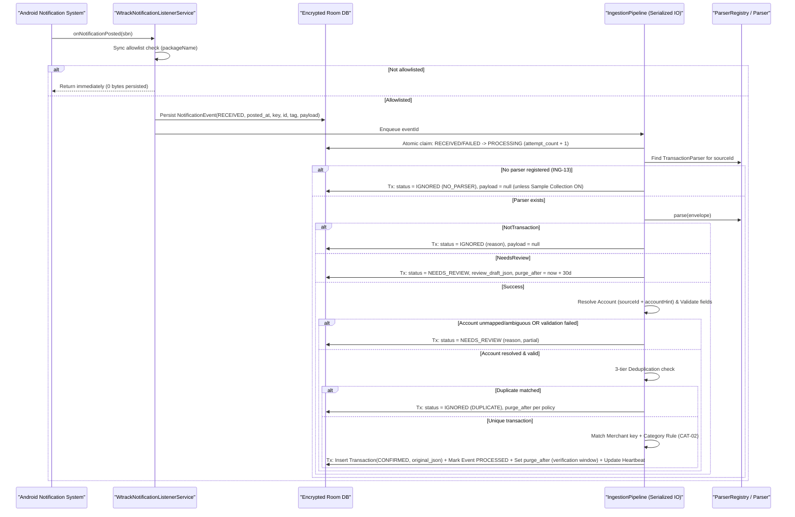
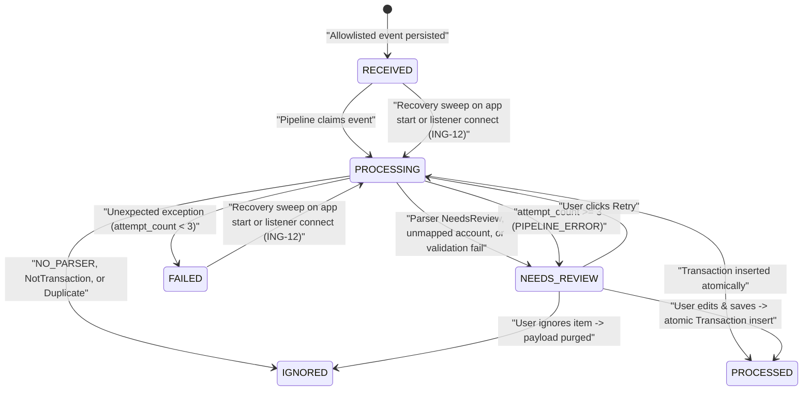

# Technical Specification — W-Track

**Document Status:** Engineering Specification aligned to PRD v1.4 (Frozen for Ingestion PoC)  
**Last Updated:** 2026-11-21

---

## 1. Integration API Contract (`:integration:api`)

Module `:integration:api` is pure Kotlin (JVM) with zero Android, Room, or Compose dependencies. All provider parsers in `:integration:providers` implement this contract.

### 1.1 Enums & Value Types (`wtrack.integration`)

```kotlin
enum class Direction { INFLOW, OUTFLOW }

/**
 * Parser-producible transaction types (PRD 6.3).
 * ADJUSTMENT belongs exclusively to the domain layer (ACC-08) and is never produced by parsers.
 */
enum class TransactionType { PURCHASE, TRANSFER, FEE, REFUND, CASH, OTHER }

enum class ReviewReason {
    MISSING_AMOUNT,
    MISSING_DIRECTION,
    INVALID_VALUE,
    AMBIGUOUS_FIELD,
    UNKNOWN_FORMAT,
    ACCOUNT_UNMAPPED,
    ACCOUNT_AMBIGUOUS,
    VALIDATION_FAILED,
    PIPELINE_ERROR,      // Set exclusively by the ingestion pipeline (ING-12)
}

enum class NotTransactionReason {
    PROMOTION,
    ANNOUNCEMENT,
    SECURITY_NOTICE,
    FAILED_ATTEMPT,      // PAR-09
    OTHER,
}
```

### 1.2 Parser Input Envelope (`NotificationEvent`)

Updated from the `38001da` draft so parsers receive structured Android notification fields without touching `StatusBarNotification` or Room entities:

```kotlin
data class NotificationEvent(
    val sourceId: String,              // Internal source ID (typically packageName in MVP)
    val packageName: String,
    val title: String?,                // Notification.EXTRA_TITLE
    val text: String,                  // Notification.EXTRA_TEXT (empty string if absent)
    val bigText: String?,              // Notification.EXTRA_BIG_TEXT
    val subText: String?,              // Notification.EXTRA_SUB_TEXT
    val channelId: String?,            // NotificationChannel ID (API 26+)
    val isGroupSummary: Boolean,       // FLAG_GROUP_SUMMARY
    val isContentRedacted: Boolean,    // True when Android 15+ redaction or empty/hidden state detected
    val postedAtEpochMillis: Long,     // Android sbn.postTime (UTC epoch millis); time fallback (PAR-12)
    val notificationKey: String?,      // Android sbn.key (idempotency evidence, section 8.1)
    val notificationId: Int,           // Android sbn.id
    val notificationTag: String?,      // Android sbn.tag (hashed if PII observed in M3a)
    val sourceEventReference: String?, // Optional provider-supplied event/message ID if exposed
)
```

### 1.3 Parser Interface & Deterministic Results

```kotlin
interface TransactionParser {
    val sourceId: String
    val version: Int
    fun supports(event: NotificationEvent): Boolean
    suspend fun parse(event: NotificationEvent): ParseResult
}

sealed interface ParseResult {
    data class Success(val transaction: ParsedTransaction) : ParseResult
    data class NeedsReview(val reason: ReviewReason, val partial: PartialTransaction?) : ParseResult
    data class NotTransaction(val reason: NotTransactionReason) : ParseResult
}

data class ParsedTransaction(
    val amountMinor: Long,             // > 0 in minor units (never 0 or negative in Success)
    val currency: String,              // ISO 4217 uppercase (e.g. "IDR")
    val direction: Direction,          // INFLOW or OUTFLOW
    val type: TransactionType,
    val occurredAtEpochMillis: Long?,  // null -> pipeline uses NotificationEvent.postedAtEpochMillis
    val merchantRaw: String?,
    val description: String?,
    val accountHint: String?,          // Masked hint only (e.g. last 4 digits); NEVER full account number
    val providerReference: String?,    // Reliably present provider reference/transaction ID
    val reportedBalanceMinor: Long?,   // Only when notification explicitly shows account balance (not credit limit!)
)

data class PartialTransaction(
    val amountMinor: Long? = null,
    val currency: String? = null,
    val direction: Direction? = null,
    val type: TransactionType? = null,
    val occurredAtEpochMillis: Long? = null,
    val merchantRaw: String? = null,
    val description: String? = null,
    val accountHint: String? = null,
    val providerReference: String? = null,
    val reportedBalanceMinor: Long? = null,
)
```

**Parser Behavioral Invariants:**
- Parsers are **pure, deterministic, and stateless**. No network I/O, no disk access, no `Locale.getDefault()` calls.
- A parser never returns `Success` if `amountMinor <= 0`, currency is blank/unverified, or `direction` is inferred loosely.
- Full account numbers must **never** be placed in `accountHint`.
- Credit card *"available credit"* must **never** be placed in `reportedBalanceMinor` (`ACC-10`).
- Outgoing reversals/refunds (`OUTFLOW` + `REFUND`) return `NeedsReview` (PRD Section 4.6).
- Multi-stage payment announcements (e.g., pending → completed/failed) emit `NotTransaction(OTHER)` for non-final stages, `Success` for final completion, and `NotTransaction(FAILED_ATTEMPT)` for failures (verified per provider during M3a).

---

## 2. Domain Layer Contracts (`wtrack.app.domain`)

`wtrack.app.domain` extends the parser types cleanly while maintaining strict isolation from Room and Android:

```kotlin
enum class DomainTransactionType {
    PURCHASE, TRANSFER, FEE, REFUND, CASH, ADJUSTMENT, OTHER
}

enum class TransactionStatus { CONFIRMED, VOIDED }
enum class AccountType { BANK, EWALLET, CASH, CREDIT_CARD, OTHER }
enum class CaptureStatus { ACTIVE, ATTENTION, DISCONNECTED, UNSUPPORTED }
enum class CategorySource { USER, RULE }
enum class TransferOrigin { MANUAL, AUTO }
enum class TransferStatus { SUGGESTED, CONFIRMED, REJECTED }
enum class NotificationEventStatus { RECEIVED, PROCESSING, PROCESSED, NEEDS_REVIEW, IGNORED, FAILED }
enum class CaptureGapReason { ACCESS_REVOKED, LISTENER_DISCONNECTED, HEARTBEAT_STALE }
```

*(Note: Full repository interfaces for `AccountRepository`, `TransactionRepository`, `NeedsReviewRepository`, `TransferRepository`, `CaptureStatusRepository`, `CategoryRepository`, `RuleRepository`, and `BackupRepository` extend the foundation outlined in `38001da`'s `FRONTEND_CONTRACT.md` without exposing Room entities or raw encryption primitives to `feature/`.)*

---

## 3. End-to-End Ingestion Pipeline & State Machine

### 3.1 16-Step Ingestion Sequence (`PRD Section 6.2`)



### 3.2 `NotificationEvent` Processing State Machine



**Recovery Rules (`ING-12`):**
- On `Application` initialization and on `onListenerConnected()`, `EventRecoveryCoordinator` queries all rows where:
  - `processing_status IN ('RECEIVED', 'FAILED')`, OR
  - `processing_status = 'PROCESSING' AND updated_at < (now - 60_000L)` (stale lease after crash/process kill).
- When `attempt_count >= MAX_ATTEMPTS` (proposed: `3`), transition directly to `NEEDS_REVIEW` with `failure_reason = PIPELINE_ERROR` rather than re-running indefinitely.

**Unsupported Source Fast-Path (`ING-13`):**
- When an allowlisted `transaction_sources` entry has no compatible `TransactionParser`:
  - Mark `IGNORED` with `failure_reason = NO_PARSER`.
  - Immediately clear `payload_json = null` (exception: if the owner manually enabled **M3a Sample Collection** for that source, retain inside encrypted DB up to `now + 14 days`, excluded from backups).
  - Never route to `NEEDS_REVIEW`.
  - Expose count over rolling 30 days (`COUNT(*) WHERE source_id = :id AND failure_reason = 'NO_PARSER' AND received_at >= :thirtyDaysAgo`) on the Accounts screen with a prompt to add manual transactions (`TX-07`).

---

## 4. Deduplication & Event Identity (`PRD Section 8.1`)

### 4.1 3-Tier Deduplication Precedence

1. **Tier 1 — Provider Reference (`provider_reference`):**
   - If the parser extracted a non-blank `provider_reference`, query existing `transactions` for the same `source_id` (or `account_id`) matching `provider_reference`. If found (whether `CONFIRMED` or `VOIDED`), treat as duplicate so voided items are never re-created (`TX-08`).
2. **Tier 2 — Stable Notification Event Identity (`stable_event_key`):**
   - Computed from: `sha256("$packageName|$identityToken|$postedAtEpochMillis|$contentHash")`.
   - Exact construction of `identityToken` (`notification_key` vs `notification_id` + `notification_tag`) is **validated empirically in M3a / `TEST-004`** across provider updates, re-posts, and grouped alerts, because Android providers sometimes update the same `(notification_id, tag)` or repost with fresh keys.
   - `notification_events` retains its row (even after `payload_json` is purged and across full backup/restore) as a permanent idempotency record (`DATA-05`).
3. **Tier 3 — Composite Transaction Fingerprint (`fingerprint`):**
   - Computed over normalized `(account_id, amount_minor, currency, direction, time_bucket_5min, normalized_merchant_or_ref)`.
   - Checked across a bounded matching window (e.g., `±5 minutes` or same day depending on M3a findings) **only as an auxiliary check** where `provider_reference` is absent and Android re-posted with a shifted `posted_at`.
   - **Prohibition:** Never deduplicate solely by `(amount_minor, timestamp)` (`PRD Section 8.1`). Two distinct coffees or tolls for the same amount minutes apart with different references/keys must remain distinct.

---

## 5. Locale-Aware Parsing, Currency & Time Rules (`PAR-12`)

### 5.1 Locale-Aware Number Parsing
1. Parsers must pass the **provider notification's detected/verified language locale** (`id-ID` vs `en-US` / `en-ID`) — never the device OS locale (`Locale.getDefault()`).
2. Explicit regex grammar handles verified patterns:
   - Indonesian style (`id-ID`): dot thousands, optional comma decimals (`Rp50.000`, `Rp 1.250.000,50`).
   - English style (`en-US`): comma thousands, optional dot decimals (`IDR 50,000.00`, `$12.50`).
3. **Thousand-Fold Misread Guard:**
   - A standalone value with an ambiguous single separator and exactly 3 trailing digits (e.g., `1.500` or `1,500` without an explicit `.00`/`,00` decimal suffix or provider-verified fixture rule) **must NEVER be guessed**. Return `NeedsReview(AMBIGUOUS_FIELD, partial)` unless the provider's M3a fixtures strictly establish a single unambiguous format across all notifications of that template.

### 5.2 Currency Exponent Registry (`CurrencySpec`)
- Do **not** assume every currency uses exponent 2 (`PRD Section 7.1`). Maintain an explicit `CurrencyRegistry`:
  - `IDR` → **Recommended: Exponent `2` (`ISO 4217`, `1 IDR = 100 sen`)** `[Confirm before M1 / DB-002]`.
    - Storage: `Rp 50.000` stores as `5_000_000L`; `Rp 1.250.000,50` stores as `125_000_050L`.
    - Parsing: `MoneyParser` scales integer Rupiah tokens by `100` cleanly (tested explicitly against **100x scaling mistakes** in addition to `PAR-12` 1,000x separator ambiguities).
    - Display: `CurrencyFormatter` elides `,00` when `amountMinor % 100L == 0L` (rendering `Rp50.000`), and displays exact 2 decimals otherwise (`Rp1.250.000,50`).
  - `USD`, `EUR`, `SGD`, `MYR` → `minorUnitDigits = 2`
  - `JPY`, `KRW` → `minorUnitDigits = 0`

### 5.3 Timestamp & Timezone Resolution (`PAR-12`)
- If the notification text includes a timestamp, parse it using the provider's verified timezone (e.g., `Asia/Jakarta` / `WIB`, `WITA`, `WIT` per provider fixture) and convert to UTC epoch millis.
- If the notification omits a usable timestamp or timestamp parsing is uncertain, set `ParsedTransaction.occurredAtEpochMillis = null`; the pipeline **always** falls back to `NotificationEvent.posted_at` (when the notification was posted by Android), **never** `received_at` (when W-Track processed or recovered it).

---

## 6. Classification Table & Aggregate Engine (`PRD Section 4.6`)

A single pure-Kotlin `AggregateCalculator` in `wtrack.app.domain.usecase` powers Dashboard, Insights, and Category Summaries. All inputs filter to `status == CONFIRMED` (voided transactions excluded per `TX-08`) and `currency == baseCurrency` (foreign-currency transactions stored, flagged, and excluded).

### 6.1 Complete 16-Row Classification Rules

| # | `Direction` | `DomainTransactionType` | Link / Pair / Condition | Income Total | Expense Total | Unreconciled (`DASH-09`) | Category & Notes |
| :-: | :--- | :--- | :--- | :--- | :--- | :--- | :--- |
| 1 | `OUTFLOW` | `PURCHASE` | None | — | `+ amount` | — | Transaction's category (or `"Uncategorized"`) |
| 2 | `OUTFLOW` | `FEE` | None | — | `+ amount` | — | `"Fees"` category |
| 3 | `OUTFLOW` | `TRANSFER` | Not paired | — | `+ amount` | — | Outgoing transfer to outside party |
| 4 | `INFLOW` | `TRANSFER` | Not paired | `+ amount` | — | — | Incoming transfer from outside party |
| 5 | `OUTFLOW` / `INFLOW` | `TRANSFER` | Confirmed pair (`TRF-01`) | Excluded | Excluded | — | Legs excluded; if `pair.feeMinor > 0`, add **derived read-only fee row** `+ feeMinor` to Expenses under `"Fees"` on outgoing leg's `accountId` & `occurredAt` (`TRF-04`) |
| 6 | `OUTFLOW` / `INFLOW` | `CASH` | Paired with cash account | Excluded | Excluded | — | Treated identically to internal transfer pair |
| 7 | `OUTFLOW` | `CASH` | Not paired | — | `+ amount` | — | Expense in `"Cash withdrawal"` category *(1.4 proposed)* |
| 8 | `INFLOW` | `CASH` | Not paired | `+ amount` | — | — | Income *(1.4 proposed)* |
| 9 | `INFLOW` | `REFUND` | Linked to original (`TX-09`) | — | `- amount` (nets spending) | — | Reduces spending in **original transaction's category**; never counted as income |
| 10 | `INFLOW` | `REFUND` | Not linked | — | `- amount` (nets spending) | — | Reduces spending in **its own category**; never counted as income |
| 11 | `OUTFLOW` | `REFUND` | None | N/A | N/A | N/A | Not produced in MVP; parsers seeing outgoing reversal emit `NeedsReview` |
| 12 | `INFLOW` | `OTHER` | None | `+ amount` | — | — | Income |
| 13 | `OUTFLOW` | `OTHER` | None | — | `+ amount` | — | Expense |
| 14 | `INFLOW` / `OUTFLOW` | `ADJUSTMENT` | None (`ACC-08`) | Excluded | Excluded | `± amount` (`+` if `INFLOW`, `-` if `OUTFLOW`) | Changes account balance; excluded from Income/Expense/Net Cash Flow (`DASH-09`) |
| 15 | Any | Any | `status == VOIDED` (`TX-08`) | Excluded | Excluded | Excluded | Excluded from totals, balances, and transfer pairs |
| 16 | Any | Any | `currency != baseCurrency` | Excluded | Excluded | Excluded | Stored and flagged; excluded from totals |

**Net Cash Flow Formula:**
$$\text{Net Cash Flow} = \text{Total Income} - \text{Total Expenses}$$
*(Where Total Expenses is net of `INFLOW + REFUND` amounts and includes `FEE` transactions plus derived `TransferMatch.feeMinor` rows, and excludes `ADJUSTMENT`, `VOIDED`, paired `TRANSFER`/`CASH` legs, and non-base currency records.)*

---

## 7. Account Balances, Checkpoints, Reconciliation & Edits

### 7.1 Estimated Account Balance (`ACC-04`, `ACC-08`)
For any account $A$:
$$\text{EstimatedBalance}(A) = (\text{initial\_balance\_minor} \lor 0) + \sum_{\substack{t \in \text{CONFIRMED}(A) \\ t.\text{occurredAt} \ge t_0}} \text{signedDelta}(t)$$
where $t_0 = \text{initial\_balance\_at}$ if set (else $-\infty$), and $\text{signedDelta}(t) = +t.\text{amountMinor}$ for `INFLOW` and $-t.\text{amountMinor}$ for `OUTFLOW`. Notice:
- Paired internal transfer legs **do** still adjust their respective account balances (only excluded from global Income/Expense!).
- Derived transfer `fee_minor` is **not** subtracted again from the outgoing account balance (`TRF-04`: *"without creating a third transaction, so no balance is changed twice"*).
- `ADJUSTMENT` transactions **do** adjust the estimated balance.

### 7.2 Balance Correction (`ACC-08`)
When the user enters `actualBalanceMinor` at `atEpochMillis`:
1. Compute `currentEstimate = estimatedBalance(accountId)`.
2. Compute `diff = actualBalanceMinor - currentEstimate`.
3. Insert a confirmed `Transaction`: `type = ADJUSTMENT`, `direction = if (diff >= 0) INFLOW else OUTFLOW`, `amountMinor = abs(diff)`, `occurredAt = atEpochMillis`, `sourceId = null`, `eventId = null`, `originalJson = null`.
4. Update `account.lastReconciledAt = atEpochMillis`.

### 7.3 Reported Balance Checkpoints (`ACC-07`, `SHOULD`)
When consecutive captured transactions on account $A$ include non-null `reported_balance_minor`:
- Compare two consecutive reports $R_1$ and $R_2$ **only** when $R_1.\text{posted\_at} < R_2.\text{posted\_at}$ strictly (skip same-timestamp or out-of-order deliveries).
- Compute $\Delta_{\text{reported}} = R_2.\text{reportedBalance} - R_1.\text{reportedBalance}$ and compare with $\Delta_{\text{captured}} = \sum \text{signedDelta}(t)$ for transactions strictly between $R_1$ and $R_2$ (inclusive of $R_2$, exclusive of $R_1$).
- If $\Delta_{\text{reported}} \ne \Delta_{\text{captured}}$, flag account $A$ with **Possible gap** (`ACC-07` / `ACC-09`). Never auto-edit transactions.

### 7.4 Transfer Linking & Edit/Void Invariants (`TRF-01`, `TRF-04`, `TX-03`, `TX-08`)
- **Link Validation:** `outgoing.accountId != incoming.accountId`, `outgoing.direction == OUTFLOW`, `incoming.direction == INFLOW`, `outgoing.currency == incoming.currency`, `outgoing.status == CONFIRMED`, `incoming.status == CONFIRMED`, neither leg is in another `CONFIRMED` pair, and `outgoing.amountMinor >= incoming.amountMinor`.
- **Derived Fee:** `feeMinor = outgoing.amountMinor - incoming.amountMinor`. Attributed in `"Fees"` to `outgoing.accountId` on `outgoing.occurredAt`.
- **Editing Captured Transactions (`TX-03`):**
  - On creation of any captured transaction, serialize immutable `original_json` containing `{amountMinor, currency, direction, transactionType, occurredAt, accountId, merchantRaw, description}`.
  - On edit: if transaction belongs to a `CONFIRMED` `TransferMatch`, re-evaluate pair invariants. If editing `amountMinor`, `currency`, `accountId`, or `direction` invalidates the pair (e.g. `outgoing < incoming` or same account/currency mismatch), **block the edit** with a clear validation message requiring the user to unlink the pair first (`PRD Section 4.5`).
  - Re-computing `feeMinor` occurs automatically if the edited amounts remain valid (`outgoing >= incoming`).
- **Void / Restore / Delete (`TX-08`):**
  - Captured transactions (`eventId != null`) may only be **voided** (`VOIDED`), never deleted, preserving `eventId` idempotency. Manual transactions (`eventId == null`) may be deleted.
  - Voiding or deleting a leg of a `CONFIRMED` `TransferMatch` requires explicit user confirmation and atomically unlinks/deletes the pair.

---

## 8. Categorization Rule Engine (`CAT-01..05`)

1. **Default Seed (`CAT-01`):** Seed system `"Uncategorized"` and `"Fees"` (plus `"Cash withdrawal"` if unpaired `CASH` rule confirmed, and standard income/expense defaults) on first DB creation. System categories cannot be deleted/archived.
2. **Merchant Key Normalization (`Section 4.9`):**
   - Lowercase, trim, normalize Unicode/diacritics, collapse repeated whitespace, strip trailing store/branch/terminal/city numeric codes (e.g., `"COFFEE SHOP 042 JAKARTA"` → `"coffee shop"` — exact token-stripping rules verified on M3a fixtures so legitimate business names with numbers are preserved carefully).
3. **Rule Matching & Precedence (`CAT-02`, `Section 4.9`):**
   - Condition matches on `(normalizedMerchantKey OR descriptionFragment)` + optional `accountId` + optional `direction`.
   - **Precedence:**
     1. `categorySource == USER` (user-edited category is **never** overwritten by rules or re-parses).
     2. Most specific matching enabled rule (specificity score = +2 if `accountId` constrained, +1 if `direction` constrained, +2 if exact `merchantKey` vs +1 if `descriptionFragment`).
     3. Tie-breaker: most recently created rule (`createdAt DESC, id DESC`).

---

## 9. Capture Status Truth Table & Heartbeat (`ACC-06`, `ING-07`, `ING-14`)

### 9.1 App-Level & Account-Level Status

| Notification Access Granted (`ING-02`) | Listener Connected (`onListenerConnected`) | Package Allowlisted (`ING-03`) | Parser Exists | Resulting Status |
| :--- | :--- | :--- | :--- | :--- |
| `false` | `false` | Any | Any | **`ATTENTION`** (permission required) |
| `true` | `false` | Any | Any | **`DISCONNECTED`** (rebind / OEM restriction) |
| `true` | `true` | `false` (for account's source) | Any | **`ATTENTION`** (source not in allowlist / no source linked) |
| `true` | `true` | `true` | `false` | **`UNSUPPORTED`** (`ING-13` — count unparsed events, prompt manual entry) |
| `true` | `true` | `true` | `true` | **`ACTIVE`** (with disclaimer: does not guarantee 100% capture) |

**Orthogonal Badge — `Possible gap`:** Displayed alongside account status whenever an overlapping `CaptureGap` (`ACCESS_REVOKED`, `LISTENER_DISCONNECTED`, `HEARTBEAT_STALE`) or unresolved balance checkpoint mismatch (`ACC-07`) exists since `last_reconciled_at`.

### 9.2 Heartbeat Mechanism & Android 16 Doze Behavior (`ING-14`)
- Persist `last_alive_at` in DataStore:
  - Whenever an allowlisted event finishes processing.
  - Periodically every ~15 minutes while listener service is active (via coroutine timer while alive + `WorkManager` periodic/best-effort refresh).
- On `onListenerConnected()` or `Application` launch: if `last_alive_at > 0 && (now - last_alive_at) > staleThresholdMillis` (proposed default: `3 hours`), insert `CaptureGap(startedAt = last_alive_at, endedAt = now, reason = HEARTBEAT_STALE)`.
- **Confirmed `iQOO Z10R (I2505)` / Android 16 Idle Note:** `dumpsys deviceidle` confirms Light Doze and Deep Doze are active with `wait_for_unlock=true`. `WorkManager` maintenance and idle exit may defer until physical screen unlock; therefore `ING-14` heartbeat diagnostics must be evaluated under default battery settings without prematurely auto-whitelisting the app.
- **Android 16 Notification Behaviors (`API 36`):** Listener extraction must cleanly tolerate lock-screen privacy masking/redaction (`ING-06`), ignore non-transaction `Notification.ProgressStyle` / Live Updates / Promoted Ongoing frequent ticks without blocking Binder threads, and observe whether provider burst notifications trigger Notification Cooldown.

---

## 10. Gate G1 Measurement Protocol (`PRD Section 17 & Appendix C`)

Before **Gate G1** opens, ADR-003 and [PROVIDERS.md](file:///home/adomancer/Documents/project/W-Track/docs/PROVIDERS.md) track the physical test device (`vivo / iQOO Z10R (I2505)`, Android 16 / API 36 confirmed as primary PoC device; other devices/OEMs remain unverified), the pre-locked thresholds, and the three prioritized PoC provider targets (**1. Bank Jago**, **2. DANA**, **3. BCA** — implemented incrementally after ingestion foundation M0–M2, with exact package IDs and notification formats verified on `iQOO Z10R` first and zero provider logic inside `WtrackNotificationListenerService`).

- **Duration & Sample Floor:** Minimum **7 consecutive days**, preferably **14 days**, on the owner's physical device; **≥ 30 actual statement transactions per provider** (extend duration if fewer occur).
- **Metrics:**
  - $A$ = Actual transactions shown in the provider's official app statement during the window.
  - $B$ = Transaction-type notifications captured by W-Track.
  - $C$ = Usable captured notifications (amount, direction, and time/postTime reliably readable).
  - $D$ = Statement transactions in $A$ that have a matching usable notification in $C$.
  - **Coverage** $= D / A$ (Proposed threshold: $\ge 90\%$).
  - **Completeness** $= C / B$ (Proposed threshold: $\ge 95\%$).
  - **Correctness** = Count of unexplained wrong amounts or wrong directions when parsed output is verified against $A$ (Proposed threshold: $0$).
  - **Account Identifiability** = Whether multi-account hints appear reliably if one app holds >1 account.
  - **Identity & Duplicates** = Observed `notification_key`, `notification_id`, `notification_tag`, `posted_at` mutations across updates/re-posts/retries.

### Decision Outcomes
- **Go:** Both providers pass thresholds → lock Gate G1 scope decisions (multi-account hints, credit card ledger, dual-notifier rule) and re-estimate M3b–M5.
- **Re-scope:** One provider misses coverage (keeps manual-assisted role or swap provider) or misses completeness (replace provider / re-evaluate channel).
- **No-go:** Neither provider meets thresholds → halt M3b–M5 investment and re-plan ingestion strategy.

*(Evidence rows are logged verbatim using the Appendix C table format in `README.md` without using app DB counts as ground truth for $A$.)*
